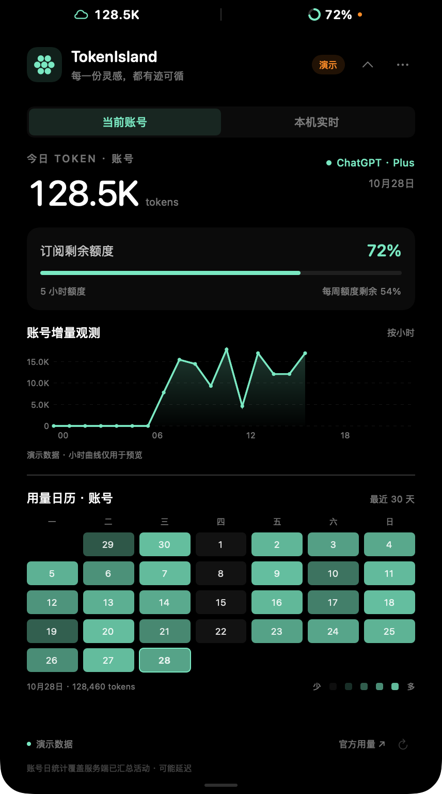

# TokenIsland

在 Mac 顶部灵动岛查看 ChatGPT Work / Codex 桌面任务的 Token 用量与订阅剩余额度。原生 SwiftUI + AppKit，macOS 14 及以上，无第三方依赖。普通 ChatGPT 聊天的完整 Token 用量暂不支持。



收起状态（无刘海屏幕，演示数据）：


## 功能

- 启动后常驻屏幕顶部：左侧为今日 Token，右侧为当前订阅窗口剩余百分比。
- 自动识别刘海，避开摄像头；无刘海显示器使用顶部居中的胶囊。
- 点击顶部数值区域展开，再次点击收起；鼠标移入、移出不改变状态，详情右上角也可收起。
- 收起时，无刘海屏幕为 220 × 28 pt；有刘海时只在硬件刘海两侧各增加 80 pt，高度贴合刘海。
- 固定画布保留图表与日历，使用 180 ms 裁切与淡入动画；窗口只在过渡边界调整尺寸，支持快速反向切换和系统“减少动态效果”。
- 默认显示当前账号日统计，可切换“本机实时”；最近 30 天日历始终展示账号日统计，点击日期查看数值。
- 多个额度桶分别显示，可切换；短周期与周额度分别展示，不混算。
- 未连接账号时提示登录，点击打开 ChatGPT 官方浏览器授权；也可直接打开 ChatGPT Mac 应用。
- 每分钟刷新、唤醒后刷新；断网时标出错误并保留上次同步时间。
- 菜单栏提供刷新、登录、打开 ChatGPT、官方用量、演示与退出。

## 构建与运行

需要 Swift 6 或以上工具链（Xcode 或 Command Line Tools），以及安装了内置 Codex CLI 的新版 ChatGPT Mac 应用。

```sh
./scripts/build-app.sh
open dist/TokenIsland.app
```

生成 `dist/TokenIsland.app` 和 `dist/TokenIsland.zip`，是本机架构的 ad-hoc 签名版本。推荐将 ZIP 解压到本机“应用程序”后运行，避免 iCloud / File Provider 给 `.app` 目录添加元数据影响签名。向其他用户分发前，需要 Developer ID 签名和公证；当前未生成公开发布版本。

开发与检查：

```sh
./scripts/build-app.sh debug
./scripts/test.sh

# 不访问账号的演示模式
dist/TokenIsland.app/Contents/MacOS/TokenIsland --demo --expanded

# 只输出连接结果和数据是否可用，不输出账号、凭证或会话内容
dist/TokenIsland.app/Contents/MacOS/TokenIsland --check-connection
```

## 数据口径与限制

应用通过 ChatGPT Mac 应用内置的 `codex app-server`，调用官方账号协议：

| 信息 | 来源 | 显示规则 |
| --- | --- | --- |
| 登录状态 | `account/read` | 用量服务的 ChatGPT 账号授权状态 |
| 账号今日与历史日历（默认） | `account/usage/read` | 服务端 `dailyUsageBuckets`，按返回日期标记展示；今日缺失显示“待同步” |
| 本机今日与小时曲线（可切换） | 本机桌面任务日志中的 Token 计数事件 | 按账号匹配，并标注“本机”；按事件时间分组，不混入 CLI / 第三方 agent |
| 订阅剩余额度 | `account/rateLimits/read` | 各额度桶各窗口的 `100 − usedPercent`，限定在 0–100% |
| 账号增量观测 | 本机对账号日累计值的差分采样 | 从启动后首次连续观测开始；不是服务端小时明细，不补造历史 |
| 登录 | `account/login/start` | app-server 托管 OAuth、保存与刷新凭证 |

这些接口提供 **ChatGPT 账号用量服务覆盖的活动**。它们不保证覆盖所有普通 ChatGPT 聊天、所有设备与所有模型，不能把 Codex/Work 的额度桶称为所有 ChatGPT 功能的统一余额。不同账号、服务端版本、套餐返回内容可能不同；界面保留额度桶名称与周期。订阅百分比也不是 API 预付费余额或剩余 Token 数。

Mac 上普通聊天的登录与用量服务授权可能不同：本版检测后者，必要时单独引导官方授权，不读取或解密 ChatGPT 的浏览器 Cookies。账号未授权和网络失败分别处理。服务端未返回的日期与额度显示“无数据”或“—”，不会伪造零消耗或 100% 余额。

服务端日统计可能只更新到昨天。默认“当前账号”模式展示服务端已汇总的跨设备活动；今日未返回时显示“待同步”，并列出最近已同步日期和数值，不会自动用本机用量、昨日用量替代或叠加。账号接口目前只提供日桶，没有可用的账号小时明细。

“本机实时”模式读取 `~/.codex/sessions/` 中属于当前账号、来源为第一方桌面端、使用 OpenAI 的 Token 计数事件；不把 CLI、VS Code 扩展或其他 agent 的日志并入。只解码会话来源、账号标识、时间戳及计数，不解码或保存聊天正文。使用累计值差分去重；分叉会话继承的父会话计数不计入新消耗。日志缺失、尚未落盘、无法识别的来源与计数修正可能导致少计。

统计范围的选择会记住。无论选择哪种模式，日历都保持**账号日统计**，不会混入本机今日值；切换仅改变今日数值和小时图。本机小时轴使用本地时区，历史日历沿用服务端日期；服务端未提供日桶时区，跨时区时可能存在日期边界差异。

账号增量采样记录日累计值变化被观测到的时间，受服务端更新延迟影响，是**观测增量**，不代表请求发生的精确小时。首次启动前、缺失数据、休眠或超过 5 分钟的采样间隔不补齐；账号今日数据未同步时，小时图说明限制，并提供切换本机曲线的入口。

参考：[官方 app-server 账号协议](https://learn.chatgpt.com/docs/app-server)、[ChatGPT 订阅与额度说明](https://learn.chatgpt.com/docs/pricing)。官方建议新集成迁移至 Sign in with ChatGPT；正式商业化前需要按官方接入要求注册自己的客户端，并确认用量读取权限。本仓库是本机开发实现。

## 本地存储

应用不收集或保存聊天内容，不读取 `auth.json`，不上传账号信息。本机日志仅解码来源、账号标识、时间戳和 Token 计数。凭证由 ChatGPT 的 app-server 管理。仅账号增量采样及差分基线保存在：

```text
~/Library/Application Support/TokenIsland/<账号标识的 SHA-256>.json
```

文件按账号隔离，目录权限 `0700`、文件权限 `0600`。演示数据与真实采样分开；未知账号不持久化。删除上述目录可清除采样记录。

## 项目结构

```text
Sources/TokenIsland/          SwiftUI 界面、悬浮窗口、菜单栏与状态管理
Sources/TokenIslandCore/      Provider 协议、ChatGPT app-server、额度模型、采样
Tests/TokenIslandCoreTests/   数据口径、日期边界、差分与 JSON-RPC 测试
Resources/Info.plist          macOS 应用配置
scripts/                     构建与测试
```

新增 agent 时实现 `UsageProvider`，将来源映射成独立日统计和额度窗口；保持数据来源、覆盖范围及估算状态可见。

构建缓存默认放在系统临时目录，避免 iCloud / File Provider 给测试包添加元数据导致签名失败；可通过 `TOKENISLAND_BUILD_DIR` 覆盖缓存路径。
